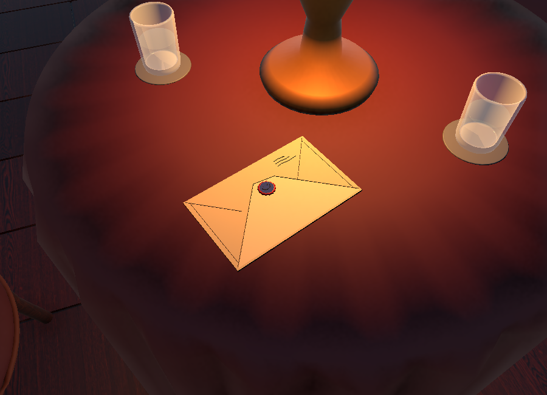

# IR5-02 — Phong bì thư kỳ lạ

- Nhóm A, không gây chết. Normal không có thư; kích hoạt anomaly thì hiện thư.
- Vị trí: `IR5V2_DetailPass/IR5V2_Table1/IR5_StrangeEnvelope`, bàn café giữa.
- Model giấy gấp kín 24 × 15 cm, dấu sáp đỏ mang nụ cười đen và vài nét mực.
  Mesh được dựng tại dự án, không dùng dịch vụ tạo model hoặc credit bên ngoài.
- Model dùng chung: `Models/InfinityRoom5Demo/IR5V2_StrangeEnvelope.obj`.
- Data: `ScriptableObjects/Anomalies/InfinityRoom5/IR5_02.asset`.
- Behaviour: dùng lại `LivingRoomArrangementAnomaly`, `Shown Objects` trỏ tới phong bì.
  Không thêm runtime script, cơ chế nhặt thư hay hệ thống tương tác mới.
- F3 mục **10**: IR5-02. Giữ nguyên chín mục cũ; F2 ẩn thư và trở về normal.
- Đã kiểm tra trực tiếp activation/reset lặp hai lần và ảnh render trong Editor;
  Code Policy PASS. Chưa chạy PlayMode/Test Runner cho nội dung này.
- Người dùng lưu scene bằng Ctrl+S. Tool dựng tạm được xóa sau khi gán xong.

