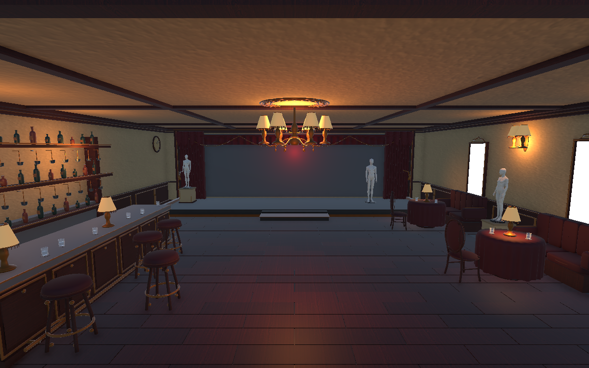
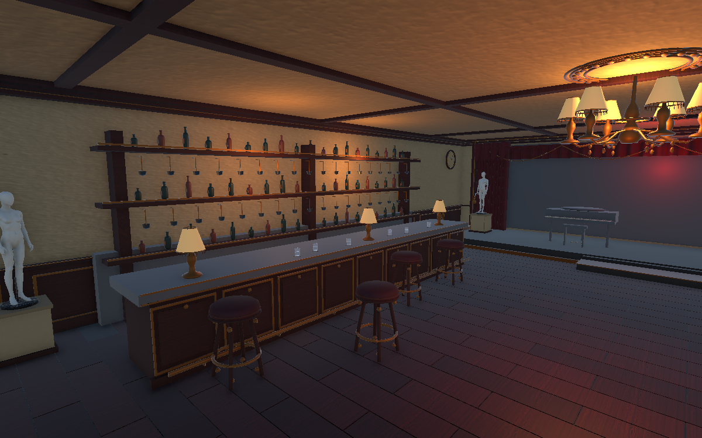

# Infinity Room 5 — The Crimson Cabaret

Campaign direction: one enclosed cabaret bar with a small red performance stage, paired with
**The Final Rehearsal** minigame. Neither is marked gameplay-ready.

## Concept target

`InfinityRoom5_CrimsonCabaret_Concept_v2.png` is the active visual reference. The standalone
Unity blockout is `Scenes/Demos/InfinityRoom5_CrimsonCabaret_Demo.unity`; its current preview is
.

## Expanded room layout

The latest layout expands both horizontal dimensions by 1.5: the floor footprint is
12.525 x 15.525 m, with approximately 12 x 15 m of interior space. Ceiling height is
unchanged. Floor, walls, architectural trim and stage width expand; decorative objects
retain their original world scale. The floor area is 2.25 times the previous area.

The bar and its lamps, stools, glasses and reflection-only Host move together toward
the west wall. Three booth/table groups spread along the east wall with their lamps,
glasses, mirrors and seated anomaly characters. The stage moves 2.5 m north, with its
steps, curtains, instruments, hand groups and stage-entry trigger. The entrance Player
and resume marker move 2.5 m south. The reflection probe volume follows the new bounds.
Existing active/inactive object choices and all runtime anomaly scripts remain unchanged.

Validation for this expansion: unchanged decorative world scales, 12 central floor-ray
samples, a clear central-aisle sphere cast, and alignment of the stage-entry trigger.
The trigger retains the original small inset from the stage edges. A native camera
render was inspected. No PlayMode/Test Runner session was run for this layout change.
The explicit temporary authoring tool is removed after use; the user saves the scene.

### Longer bar and backbar

The counter top is now 7.347 m long (previously 4.898 m); the backbar cabinet is
8.25 m long (previously 5.5 m). Both are 1.5 times their previous length. These use
new authored geometry, `IR5V2_OrnateBar_Long.obj` and `IR5_BackBarDisplay_Long.obj`,
with the original scene Transform scales and original material assignments.
The counter has nine decorative front panels instead of six. The backbar has an
additional central support, 57 normal-size bottles and 36 suspended glass racks.
Cross-section dimensions, panel details, bottles and glass sizes remain unchanged.
The separate collision proxies extend to match; existing stools and counter lamps
are distributed along the longer top. Glass/anomaly object references are preserved.

- One continuous old cabaret bar with a shallow red performance stage and worn velvet curtains.
- Dark wood bar counter, aged brass foot rail, glass shelves and amber practical lamps.
- Several mannequins stored/displayed as static decor beside walls and costume racks; they are
  not audience and are not arranged to watch the stage.
- The stage is empty, dim and ominous, with only a faint deep-red glow behind the curtains.
- Scuffed parquet, faded gilt trim, red upholstery and tarnished brass.
- A readable center route with access to the stage; mannequins do not block traversal.

The refined demo has continuous, unclothed ivory mannequin meshes (three full figures and five
display busts), curved upholstered bentwood chairs, padded velvet booths, pleated tablecloths,
fringed lamps, gilded display panels, an ornate bar and a closed stage piano. The original crude
props remain inactive for recoverability; the active replacements are under `IR5V2_DetailPass`.
The main route stays open. Mannequins are static display props, not an audience.

The layout pass fixes buried display bases, pedestal/booth overlaps, stools intersecting the
bar rail, overlapping trunks, and the piano bench hanging beyond the stage. Collider proxies
are attached to their furniture roots so they follow transforms. Lamps rest above tabletops;
wall sconces sit above the displays rather than inside the mirror frames.

This remains locally authored demo art, not a photorealistic reproduction of the concept.
Final wear/normal maps, lighting bake and production asset polish remain separate art work.
The three framed wall panels now use the same planar reflection system as `MirrorRoot`
in `Prefabs/Environment/Room.prefab`. Each has a dedicated reflection camera and plane;
see [planar mirror setup](PLANAR_MIRRORS.md). They retain their existing frames and meshes.

## Layout verification

- `python -B Documentation/InfinityRoom5Demo/validate_crimson_layout.py` performs a read-only
  world-space AABB check of 25 main solid props and verifies stage support/curtain clearance.
  It deliberately excludes attached lamps, wall trim and other intentional assembly contacts.
- A five-second UnitySkills Play Mode observation completed with zero runtime errors.
  This is a smoke check, not a full player traversal or performance certification.
- [Seating inspection](Room5_SeatingQA.png) shows an additional camera angle.
- `finish_crimson_layout.py` is an explicit, repeatable correction, not a scene builder and
  never runs automatically or saves the scene. Do not run the old initial creation stages again.

This replaces the Dressing Room direction and remains paired with The Final Rehearsal. It follows
the performance theme and the earlier concepts' neglected late-1990s/early-2000s interior language.
It does not replace Room4's hotel kitchen. Open the demo scene directly in Unity for inspection.
It is not in Build Settings and does not replace or modify InfinityRoom1 or any campaign
scene/prefab. The scene now includes standalone anomaly previews, but no campaign bootstrap or
production Room5 flow. Collider proxies are not final collision tuning.

## Anomaly preview

F2 restores the normal room. F3 cycles IR5-01 → IR5-05 → IR5-06 → IR5-09 → IR5-10 → IR5-12 → IR5-16 → IR5-11 → IR5-13 → IR5-02 → IR5-07 → IR5-04 → IR5-08.
The tenth preview adds a small sealed envelope on `IR5V2_Table1`; F2 hides it.
It reuses `LivingRoomArrangementAnomaly` and has its own `IR5_02.asset` data.
The eleventh preview turns the necks of seven decorative rigged mannequins toward
the Player camera while inside the room; F2 restores their authored neck poses.
See [IR5-07](IR5_07_WATCHING_MANNEQUINS.md).
The twelfth preview shows eight Catch the Rabbit rabbits inside the user-authored
under-counter recess, visible from the rear bar aisle. They share `PF_IR5_BarRabbit`,
which nests the original Minigame 3 Rabbit with its Animator disabled to hold its
waiting pose. The group is `IR5V2_DetailPass/IR5V2_Bar/IR5_04_RabbitWarren`;
F2 hides it. `IR5_Anomalies/IR5_04_BarRabbits` reuses `LivingRoomArrangementAnomaly`
with `IR5_04.asset`; it has no lethal or fleeing behaviour.
The thirteenth preview is the invisible bartender: approach the customer side of
the bar and a shelf bottle floats down, uncaps, pours into an empty glass and
serves it. The bottle returns to the shelf; the filled glass remains until F2.
See [IR5-08 authoring and timings](IR5_08_INVISIBLE_BARTENDER.md).
The seventh preview is lethal: the seated Host stands and snaps, marking a fixed black hole at
the Player's feet. Leave the warning circle within 1.2 seconds, and avoid it while open.
See [IR5-16 controls and timing](IR5_16_FINGER_SNAP.md). This does not mark the campaign ready.

The eighth preview is nonlethal: IR5-11 seats the Host on the last bar stool, playing Sitting
while the neck tracks the stage. See him once, look away for 0.3 seconds, then look back:
he disappears and the nearby glass briefly rattles. See [IR5-11](IR5_11_BAR_GUEST.md).

`InfinityRoom5_CrimsonCabaret_Concept.png` is retained as the superseded first draft; its
mannequins resembled an audience and the stage was too bright. The older
`InfinityRoom5_DressingRoom_Concept.png` is also retained as an earlier superseded draft.

## Provenance

- Generated using the built-in image generation tool on 2026-10-05.
- No external artist/style attribution requested; no third-party reference image used.
- Prompt: [concept-prompt-v3.txt](concept-prompt-v3.txt).
- Mesh and scene authoring scripts in this folder are explicit manual tools only; they do not run
  on editor startup, compile, or scene load. Do not rerun a stage against a populated scene unless
  you intend to recreate that stage in the current demo.
- Status: standalone visual demo; not yet campaign-ready.
