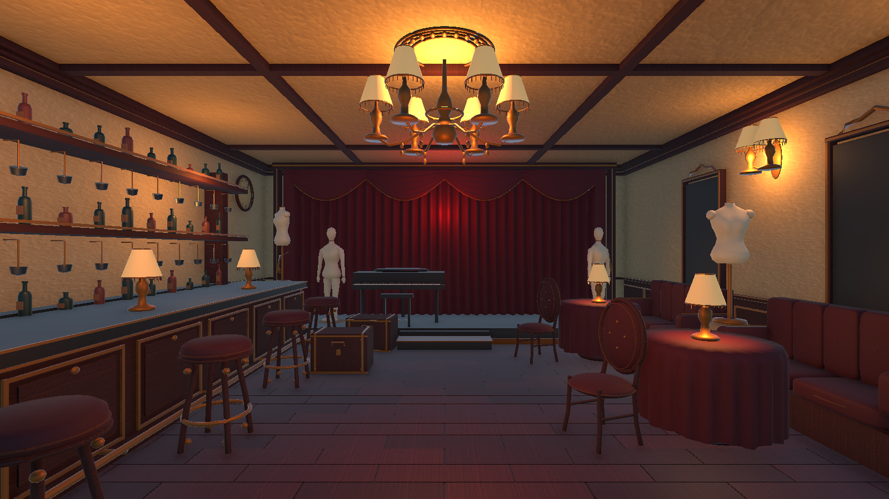

# Infinity Room 5 — The Crimson Cabaret

Campaign direction: one enclosed cabaret bar with a small red performance stage, paired with
**The Final Rehearsal** minigame. Neither is marked gameplay-ready.

## Concept target

`InfinityRoom5_CrimsonCabaret_Concept_v2.png` is the active visual reference. The standalone
Unity blockout is `Scenes/Demos/InfinityRoom5_CrimsonCabaret_Demo.unity`; its current preview is
.

- One continuous old cabaret bar with a shallow red performance stage and worn velvet curtains.
- Dark wood bar counter, aged brass foot rail, glass shelves and amber practical lamps.
- Several mannequins stored/displayed as static decor beside walls and costume racks; they are
  not audience and are not arranged to watch the stage.
- The stage is empty, dim and ominous, with only a faint deep-red glow behind the curtains.
- Scuffed parquet, faded gilt trim, red upholstery and tarnished brass.
- A readable center route with access to the stage; mannequins do not block traversal.

The refined demo has continuous, unclothed ivory mannequin meshes (three full figures and five
display busts), curved upholstered bentwood chairs, padded velvet booths, pleated tablecloths,
fringed lamps, gilded display panels, an ornate bar and a closed stage piano. The original crude
props remain inactive for recoverability; the active replacements are under `IR5V2_DetailPass`.
The main route stays open. Mannequins are static display props, not an audience.

The layout pass fixes buried display bases, pedestal/booth overlaps, stools intersecting the
bar rail, overlapping trunks, and the piano bench hanging beyond the stage. Collider proxies
are attached to their furniture roots so they follow transforms. Lamps rest above tabletops;
wall sconces sit above the displays rather than inside the mirror frames.

This remains locally authored demo art, not a photorealistic reproduction of the concept.
Final wear/normal maps, lighting bake and production asset polish remain separate art work.
The dark framed wall panels are decorative meshes, not functional reflection mirrors.

## Layout verification

- `python -B Documentation/InfinityRoom5Demo/validate_crimson_layout.py` performs a read-only
  world-space AABB check of 25 main solid props and verifies stage support/curtain clearance.
  It deliberately excludes attached lamps, wall trim and other intentional assembly contacts.
- A five-second UnitySkills Play Mode observation completed with zero runtime errors.
  This is a smoke check, not a full player traversal or performance certification.
- [Seating inspection](Room5_SeatingQA.png) shows an additional camera angle.
- `finish_crimson_layout.py` is an explicit, repeatable correction, not a scene builder and
  never runs automatically or saves the scene. Do not run the old initial creation stages again.

This replaces the Dressing Room direction and remains paired with The Final Rehearsal. It follows
the performance theme and the earlier concepts' neglected late-1990s/early-2000s interior language.
It does not replace Room4's hotel kitchen. Open the demo scene directly in Unity for inspection.
It is not in Build Settings and does not replace or modify InfinityRoom1 or any campaign
scene/prefab. The scene is a visual/layout reference only: no anomaly, campaign bootstrap, or Room5
gameplay is wired. Collider proxies are for scale and blocking checks, not final collision tuning.

`InfinityRoom5_CrimsonCabaret_Concept.png` is retained as the superseded first draft; its
mannequins resembled an audience and the stage was too bright. The older
`InfinityRoom5_DressingRoom_Concept.png` is also retained as an earlier superseded draft.

## Provenance

- Generated using the built-in image generation tool on 2026-10-05.
- No external artist/style attribution requested; no third-party reference image used.
- Prompt: [concept-prompt-v3.txt](concept-prompt-v3.txt).
- Mesh and scene authoring scripts in this folder are explicit manual tools only; they do not run
  on editor startup, compile, or scene load. Do not rerun a stage against a populated scene unless
  you intend to recreate that stage in the current demo.
- Status: standalone visual demo; not yet campaign-ready.
